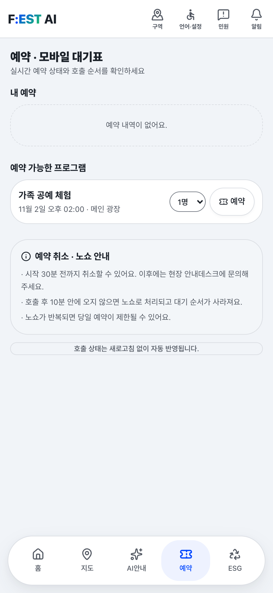
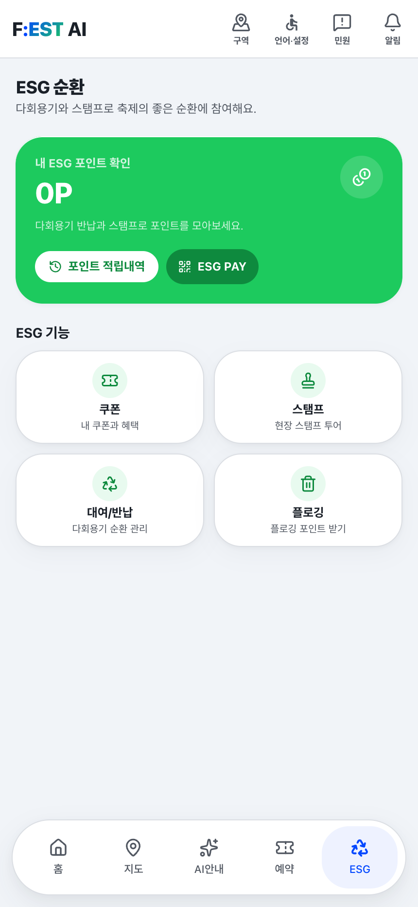
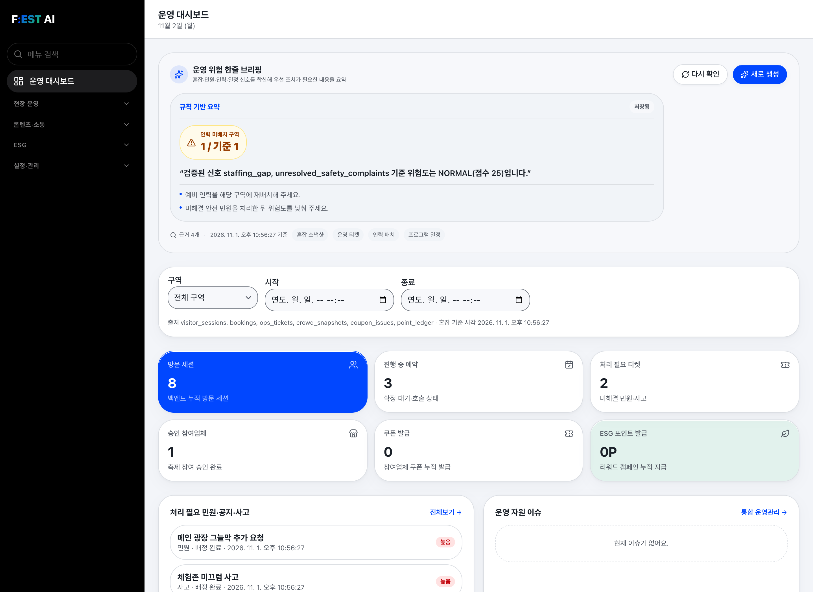
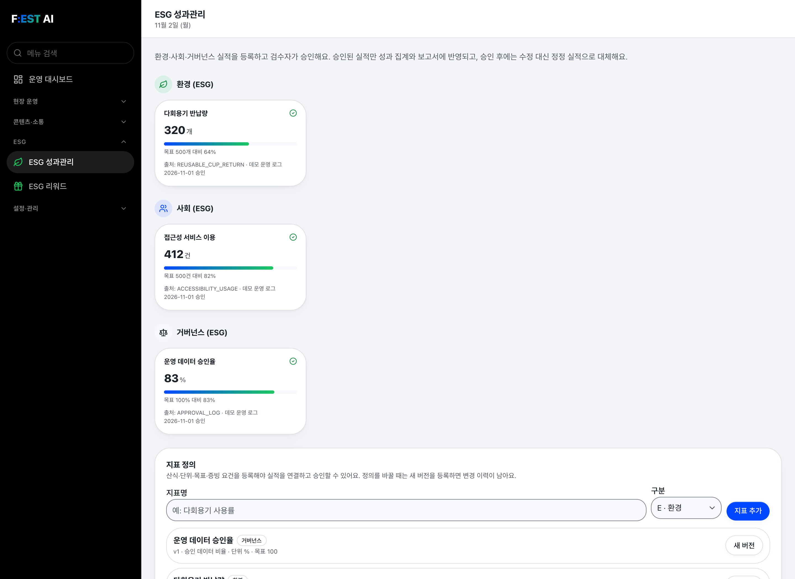
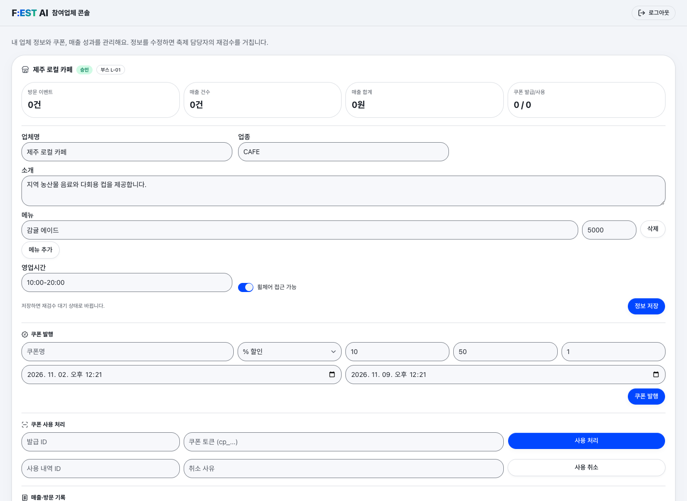
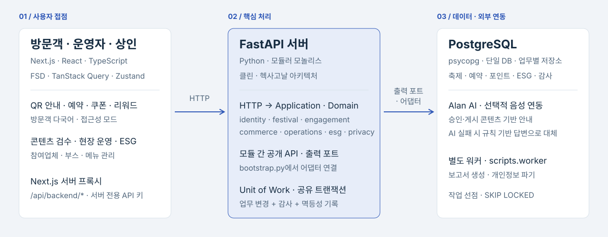

# FESTAI

## 소개

지역축제의 방문객 안내, 현장 운영, ESG 성과 관리를 통합하는 AI·ESG 플랫폼입니다(방문객 웹·운영자 콘솔·참여업체 콘솔·API 모노레포).

### 핵심 기능


### 주요 화면

#### 방문객 · AI 안내와 축제 참여

| 01. AI·음성 안내 | 02. 예약·모바일 대기표 | 03. ESG 참여·포인트 |
| :-: | :-: | :-: |
|  |  |  |

#### 운영자 · 01. 운영 대시보드



<details>
<summary>운영자 · 02. ESG 성과관리</summary>



</details>

<details>
<summary>참여업체 · 01. 부스·메뉴·쿠폰 관리</summary>



</details>

## 기술 스택

| 영역 | 구성 | 의존성 |
| --- | --- | --- |
| 백엔드 | Python · FastAPI · PostgreSQL · Psycopg · PyJWT | [pyproject.toml](backend/pyproject.toml) |
| 프론트엔드 | Next.js · React · TypeScript · TanStack Query · Tailwind CSS · shadcn | [package.json](frontend/package.json) |
| 음성 런타임 | CosyVoice 3 · PyTorch · SoundFile | [requirements.txt](backend/voice/requirements.txt) |

외부 연동: [외부 서비스 연결](#외부-서비스-연결) · [음성 런타임](#음성-런타임-시작하기) · 배포: [배포 가이드](docs/05-ops/01-deploy.md)

### 아키텍처

백엔드는 7개 업무 모듈의 **모듈러 모놀리스·헥사고날 구조**입니다([모듈·의존성 규칙](docs/03-tech/01-architecture.md#모듈-경계와-의존성) · [소스 구조](docs/03-tech/01-architecture.md#소스-구조)).



## 시작하기

[백엔드](#백엔드-시작하기) → [프론트엔드](#프론트엔드-시작하기) → (선택) [음성 런타임](#음성-런타임-시작하기) 실행 후 [웹(3000)](http://localhost:3000)과 [API 문서(8000)](http://localhost:8000/docs)에 접속합니다.

### 백엔드 시작하기

Python 3.12+·Docker 필요(`backend/` 기준, `.env` 자동 미로딩이므로 터미널마다 `source .env` 실행; 설정: [backend/.env.example](backend/.env.example) · [config.py](backend/app/infrastructure/config.py)).

```bash
cp .env.example .env && set -a && source .env && set +a
docker compose up -d postgres
python3 -m venv .venv
.venv/bin/pip install -e '.[dev]'
.venv/bin/python -m scripts.migrate
.venv/bin/python -m scripts.seed
.venv/bin/uvicorn app.main:app --reload
# 별도 터미널(backend/): 보고서·개인정보 파기 워커
set -a && source .env && set +a && .venv/bin/python -m scripts.worker
```

### 프론트엔드 시작하기

Node.js 20+·npm 및 마이그레이션·시드 완료 API 필요(`frontend/` 기준, [frontend/.env.example](frontend/.env.example)). `BACKEND_URL`에는 `/api/v1`을 붙이지 않으며 `NEXT_PUBLIC_` 없는 변수는 Next 서버 전용입니다.

```bash
npm ci && cp .env.example .env.local && npm run dev
```

### 음성 런타임 시작하기

Python·PyTorch·GPU, [CosyVoice](https://github.com/FunAudioLLM/CosyVoice#install) 저장소·`Fun-CosyVoice3-0.5B` 가중치·참조 WAV 필요(저장소 미포함, `COSYVOICE_PROMPT_WAV` 생략 시 `asset/zero_shot_prompt.wav` 사용).

```bash
# PowerShell: $env:COSYVOICE_REPO_PATH="C:\models\CosyVoice" 등
export COSYVOICE_REPO_PATH=/path/to/CosyVoice
export COSYVOICE_MODEL_PATH=/path/to/Fun-CosyVoice3-0.5B
export COSYVOICE_PROMPT_WAV=/path/to/CosyVoice/asset/zero_shot_prompt.wav
# backend/voice/에서 실행
python -m pip install -r requirements.txt
python -m uvicorn server:app --host 127.0.0.1 --port 8100
```

## 사용 방법

| 대상 | 경로([src/app](frontend/src/app)) | 주요 기능 |
| --- | --- | --- |
| 공통 / 방문객 | `/`, `/visitor` | 랜딩, AI·음성 안내, 예약·대기표, 쿠폰·리워드·설문 |
| 운영자 | `/admin` | 콘텐츠 검수, 현장 운영, 참여업체 심사, ESG·감사 로그 |
| 참여업체 | `/merchant`, `/merchant-invite` | 부스·메뉴·쿠폰 관리, 초대 가입 |

플로깅·다회용기 기록과 포인트는 방문객 화면의 서버 발급 QR을 운영자가 스캔해 서버에 저장합니다(기존 브라우저 데모 기록은 자동 이관·적립 안 함). 보고서 출력 제약은 [남은 작업](docs/03-tech/01-architecture.md#남은-작업과-리스크)을 참고합니다.

### API 접속

- 기본 경로: `http://localhost:8000/api/v1` · Scalar: [`/docs`](http://localhost:8000/docs) · OpenAPI: [`/openapi.json`](http://localhost:8000/openapi.json)
- 헬스체크: `/health/live`, `/health/ready`(DB 연결 포함) · Bruno: [backend/bruno](backend/bruno)(Local 환경)

### 데모 계정과 시드

로컬·데모 전용(운영 환경 실행 금지, 재실행 시 비밀번호 초기화). 공통 비밀번호: `ChangeMe123!`

| 역할 | 최고 관리자 | 축제 담당자 | 검토 담당자 | 현장 운영자 | 참여 상인 |
| --- | --- | --- | --- | --- | --- |
| 이메일 | `admin@example.com` | `manager@example.com` | `reviewer@example.com` | `operator@example.com` | `merchant@example.com` |

`scripts.seed`는 조직·계정 5명·`EST34-2026` 축제·구역·시설·프로그램·설문·티켓·ESG 실적·업체·쿠폰·혼잡·리워드·문서를 멱등 생성합니다. 추가 데모 데이터:

```bash
.venv/bin/python -m scripts.jeju_esg_2026                        # 드라이런(--apply로 커밋)
psql "$DATABASE_URL" -f scripts/est34_2026_demo_enrichment.sql   # EST34-2026 운영 보강
psql "$DATABASE_URL" -f scripts/allen_demo_data.sql              # ALLEN-DEMO-2026 샌드박스
```

### 다국어 사전 재생성

원본 `src/shared/lib/i18n/dictionaries/ko.ts` 수정 후 `GOOGLE_TRANSLATE_API_KEY=... npm run i18n`으로 `en/zh/ja`를 생성합니다(생성물 직접 수정 금지, `npm test`가 해시 검증, `/visitor`만 다국어 지원·`/admin`과 `/merchant`는 한국어 고정).

### 외부 서비스 연결

- Kakao 지도: 개발 도메인 등록 필요(키 없으면 좌표 목록 표시).
- 번역 API: 키 없으면 생성된 UI 사전만 사용(운영자 콘텐츠는 원문 표시).
- LiveAvatar: 테스트 시 `LIVEAVATAR_SANDBOX=true`.
- 음성 합성: 원격 합성 실패 시 브라우저 내장 음성으로 자동 대체.

### 음성 런타임 사용 방법

`frontend/.env.local`에 아래 값을 설정하고 Next.js를 재시작하면 `/api/voice/synthesize` 프록시가 런타임([server.py](backend/voice/server.py), [Scalar](http://127.0.0.1:8100/docs))을 호출합니다.

```dotenv
NEXT_PUBLIC_VOICE_MODE=remote
VOICE_RUNTIME_URL=http://127.0.0.1:8100
```

## 테스트

검증 범위: [테스트 명세](docs/04-test/01-verification.md#검증-전략).

### 백엔드 테스트

`backend/`에서 전용 로컬 PostgreSQL 테스트 DB(`DATABASE_URL`)로 실행합니다(픽스처가 마이그레이션·시드·잡을 처리하므로 워커 미실행, DB 미연결 스킵은 미통과, 데이터 생성 주의; 상세: [tests](backend/tests)).

```bash
.venv/bin/python -m pytest -q
.venv/bin/python -m compileall -q app scripts tests
API_URL=http://127.0.0.1:8000/api/v1 .venv/bin/python -m scripts.smoke  # 실행 중인 API 필요
```

### 프론트엔드 테스트

`frontend/`에서 실행합니다(사전 빌드 불필요; 상세: [tests](frontend/tests)).

```bash
npm test && npm run lint && npm run build
```

### 음성 런타임 테스트

`curl http://127.0.0.1:8100/health`(PowerShell: `curl.exe`)로 `ready: true`(모델 로드)를 확인하고, Scalar의 `POST /v1/speech/synthesize`로 실제 음성 합성을 검증합니다.

## 관련 문서

- [작업 지침](AGENTS.md): 작업 순서·문서 관리.
- 팀: [강덕현](https://github.com/duckduck-e)(프론트엔드) · [김나영](https://github.com/nadanaya)(백엔드) · [서하니](https://github.com/gksl3690)(기획) · [심주혜](https://github.com/juuhye)(프론트엔드) · [정상겸](https://github.com/ken-jeong)(풀스택)

### 문서 분류 기준

<!-- doc-standard:start — doc-standard에서 동기화한다. 이 구간은 직접 고치지 않는다. -->
| 위치 | 담는 내용 |
| --- | --- |
| [`docs/01-func/`](docs/01-func/01-requirements.md) | 범위, 역할별 기능, 업무 정책, 완료 기준 |
| [`docs/02-uxui/`](docs/02-uxui/01-design.md) | 화면 배치·조작·디자인 기준·시각 자산 |
| [`docs/03-tech/`](docs/03-tech/README.md) | 아키텍처, 소스 구조, 데이터 모델, REST/IPC 계약 |
| [`docs/04-test/`](docs/04-test/01-verification.md) | 검증 방법, 판정 기준, 최신 판정과 증거 |
| [`docs/05-ops/`](docs/05-ops/01-deploy.md) | 배포·인프라 구성·운영 점검·장애 대응 |
| `docs/` 루트·주제 폴더 | 비명세 자료(과제 안내, 보고서, 발표, 협업 규칙, 자료 수집 기록) |
| 코드 저장소 루트 README | 로컬 설치·실행·테스트 명령 |

API 상세 원본은 OpenAPI·라우터·DTO이며 명세에는 원본 위치와 한계만 적는다. 배포 절차는 `05-ops/`(없으면 기술 명세)에 두고 로컬 실행 명령은 README를 링크한다.
<!-- doc-standard:end -->
