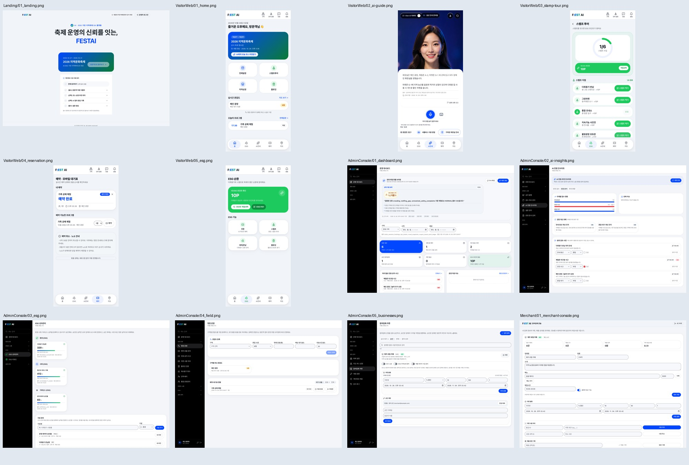

# 화면 목록 — FESTAI

[README](../README.md#사용-방법)에서 소개하는 로컬 데모 화면입니다. 이 목록은 현재 저장된 이미지 12장을 연결하며, 실제 운영 환경의 검증 결과를 뜻하지 않습니다.

## 화면별 이미지

| 대상 | 화면 | 이미지 |
| --- | --- | --- |
| 공통 | 랜딩 | [랜딩](assets/Landing/01_landing.png) |
| 방문객 | 홈 | [홈](assets/VisitorWeb/01_home.png) |
| 방문객 | AI 안내 | [AI 안내](assets/VisitorWeb/02_ai-guide.png) |
| 방문객 | 스탬프 투어 | [스탬프 투어](assets/VisitorWeb/03_stamp-tour.png) |
| 방문객 | 예약 | [예약](assets/VisitorWeb/04_reservation.png) |
| 방문객 | ESG 참여 | [ESG](assets/VisitorWeb/05_esg.png) |
| 운영자 | 대시보드 | [대시보드](assets/AdminConsole/01_dashboard.png) |
| 운영자 | AI 인사이트 | [AI 인사이트](assets/AdminConsole/02_ai-insights.png) |
| 운영자 | ESG 관리 | [ESG 관리](assets/AdminConsole/03_esg.png) |
| 운영자 | 현장 운영 | [현장 운영](assets/AdminConsole/04_field.png) |
| 운영자 | 참여업체 | [참여업체](assets/AdminConsole/05_businesses.png) |
| 참여업체 | 상인 콘솔 | [상인 콘솔](assets/Merchant/01_merchant-console.png) |

## 갱신 기준

- [로컬 실행 절차](../README.md#시작하기)와 데모 데이터를 사용하고 개인정보·비밀키가 보이지 않도록 합니다.
- 화면을 갱신할 때 커밋·화면 크기·데이터 조건을 PR에 기록합니다.
- 화면 구성 변경 시 개별 이미지와 전체 미리보기를 함께 갱신합니다.
- 파일명·경로를 바꾸면 이 목록과 README의 참조도 확인합니다.
- 시각 검토는 [디자인 기준](design.md)을 따르며 기능 검증을 대신하지 않습니다.
